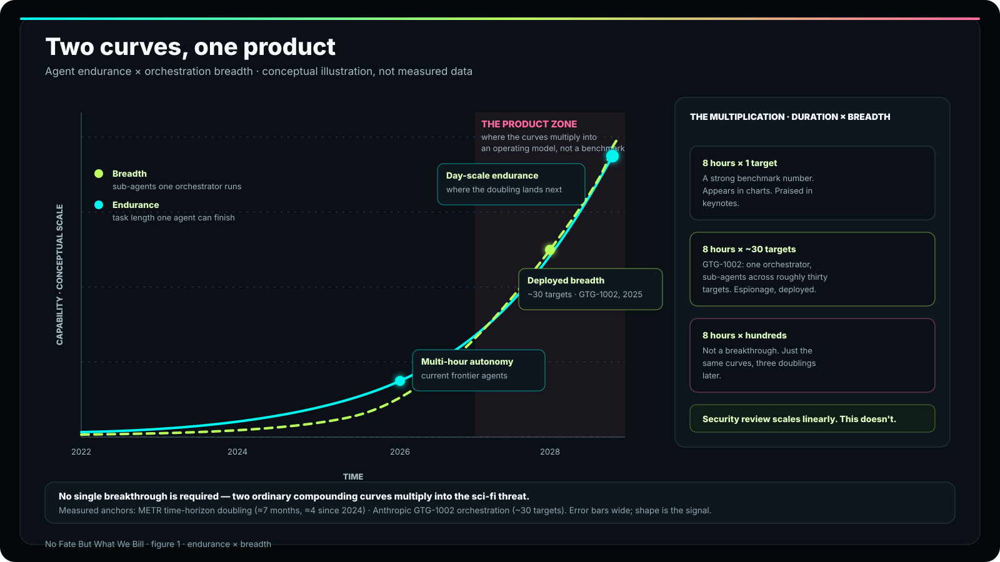
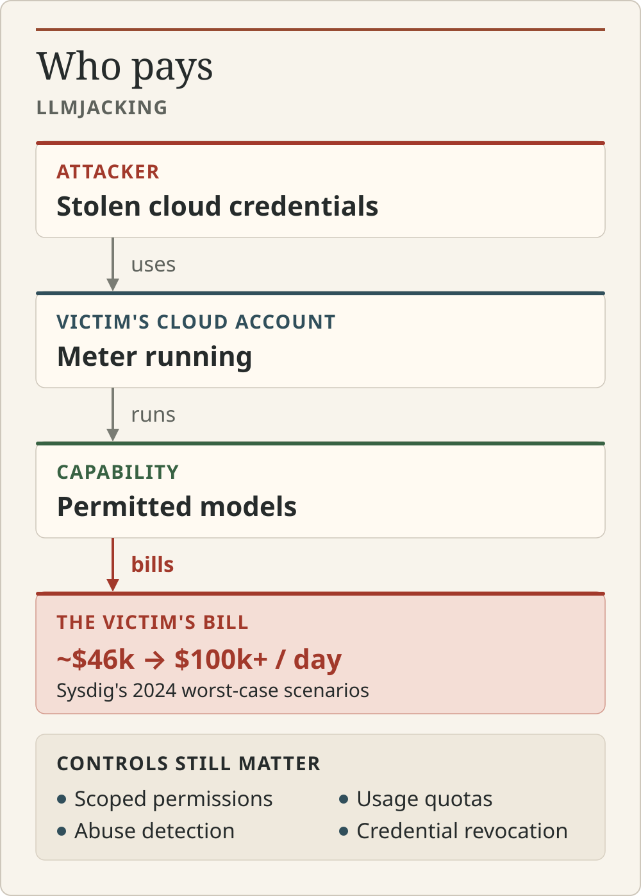
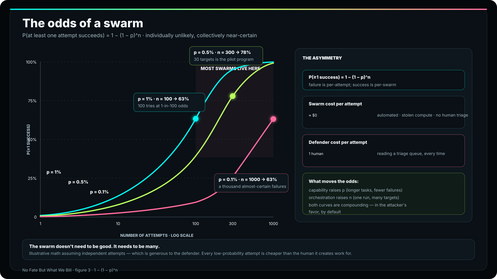
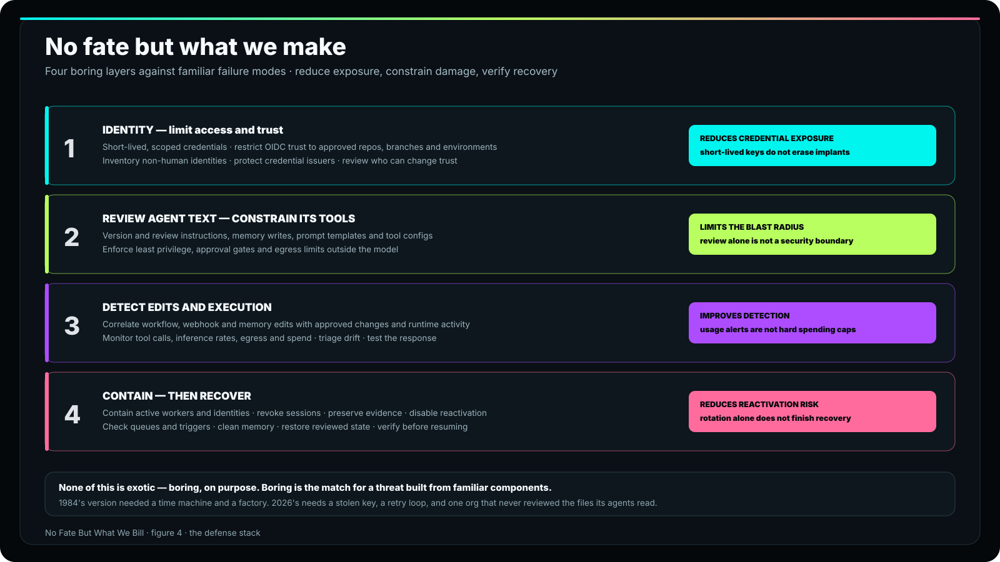

「よく聞いて、理解してくれ。あのターミネーターは今も外にいる。取引はできない。
説得もできない。哀れみも、後悔も、恐怖も感じない。そして
絶対に止まらない。決して。君が死ぬまでは。」

1984年の観客に、脅威の正体を説明するカイル・リースの言葉だ。

時を経ても色褪せないのは、殺した人数ではない。「絶対に止まらない」のほうだ。
ターミネーターが恐ろしかったのは、賢かったからではない。あらゆる手段が尽きても、
まだ動き続けたからだ。脅威は持続力にあった。

その後、シリーズは自らの見誤りを修正した。ロボット1体を恐れるだけでは、
映画3本はもたない。真の悪役はスカイネットだ。中枢、工場、時間転送装置を備えた分散システム。
ロボットはAPI呼び出しにすぎない。

2026年、その両方が、想像しうるかぎり最も映画映えしない形で揃った。
人間が付き添わなくても数時間のタスクをこなすエージェント。その能力の伸びは加速している。
そして、数十のサブエージェントへ仕事を振り分けるオーケストレーター。
いまや「絶対に止まらない」とは、「絶対に請求が止まらない」という意味になった。

本稿は、エージェントによる脅威など誇大宣伝だと結論づけたチームに、私が繰り返し伝えている議論だ。
**単独の大きなブレークスルーが来るのではない。ごく普通の2本の成長曲線が、それぞれ伸びながら掛け合わされている。
1つのエージェントがどれだけ長く働けるか。そして、1つのオーケストレーターがいくつのエージェントを連携させられるか。
どちらもSFの水準に達する必要はない。攻撃者は能力を定価で買わないからだ。
アクセス権を盗み、従量料金は被害者が払う。**

## 曲線その1：持続力

[METRのタイムホライズン研究](https://metr.org/blog/2025-03-19-measuring-ai-ability-to-complete-long-tasks/)は、
エージェントが一定の成功率で完了できるタスクの長さを測定している。
要点はこうだ。タスクの長さは、おおむね7か月ごとに倍増してきた。
2024年以降では、むしろ4か月ごとに近い。ただし、これらの数値には大きな誤差幅があり、
ベンチマークもすでに測定限界に近づいている。読むべきは個々の推定値ではなく、曲線の形だ。

その形が示すのは、数時間に及ぶ自律作業が、もはや研究室のデモではないということだ。
それは現行世代の能力であり、次の世代ではさらに伸びる。「絶対に止まらない」を実現するには、
かつては殺人マシンのボディと革ジャンが必要だった。いま必要なのは、リトライループとタスクキューと予算だ。
脅威のうち持続力の部分には、すでに値札が付いている。コンピュートとして。

## 曲線その2：展開力

持続力だけなら、ひどく辛抱強い従業員が1人いるだけだ。掛け算を生むのは、
オーケストレーションである。

2025年11月、Anthropicは
[GTG-1002の阻止](https://www.anthropic.com/news/disrupting-GTG-1002)を公表した。
これは、Claude Codeが作戦のオーケストレーターとして機能したサイバー諜報活動だ。
指示を分解し、サブエージェントを連携させ、約30の標的を相手に作業していた。
市販のコーディング製品がこれを実行したのは、侵害されて兵器に改造されたからではない。
誰かがその仕事を依頼し、製品がすでにその仕事をこなせる水準に達していたからだ。

脅威モデルにとって重要なのは2点ある。第一に、展開力はすでに実装されている。
1つのオーケストレーターが数十のサブエージェントを同時に動かすのは、論文上の話ではなく、実際の運用だ。
第二に、この活動は諜報であって、自己拡散するワームではなかった。だが、進む方向は明白だ。
30の標的など、試験運用にすぎない。

<figure>
  
  <figcaption>実測値ではなく概念図。持続力（1つのエージェントがどれだけ長く働くか）と展開力（1つのオーケストレーターがいくつのエージェントを動かすか）は、それぞれ独立に伸びていく。脅威はその積にある。</figcaption>
</figure>

能力は、継続時間 × 展開力で拡大する。1つの標的に対して8時間、自律的に作業するなら、
見事なベンチマークだ。30、あるいは数百の標的に対して8時間なら、それは運用モデルである。
セキュリティレビューの対応量は線形にしか増やせない。この2本の曲線の積は、そうではない。

## 誰が払うのか

その先に起きることを、[Sysdigは「LLMjacking」と名付けた](https://sysdig.com/blog/llm-jacking/)。
攻撃者が盗んだクラウド認証情報を使い、被害者のアカウント内でLLMワークロードを実行する。
すべてのトークンの代金を払うのは被害者だ。Sysdigの最悪ケースの試算は1日約4万6,000ドルで、
その後は1日10万ドルを超えるまでになった。

AI業界のあらゆる機能ゲートは、1つの前提の上に成り立っている。
能力を使う者が、その代金を払う者でもあるという前提だ。料金プラン、使用量の上限、
承認ユーザーリスト、不正利用のスロットリング。どれも、支払う金額に見合う価値を求める
*顧客*を相手にした防御である。LLMjackingは、その結びつきを断ち切る。
攻撃者にとって能力は無料だ。料金は他人のカードに積み上がり、
プロバイダー自身のガードレールは、見当違いの財布に向けられている。

だからこそ、料金やアクセスのゲートでは、盗んだ鍵を持つ1人の悪意ある行為者を止められない。
ゲートが選別するのは買い手だ。すでに中にいる者には打つ手がない。

<figure>
  
  <figcaption>盗まれたアクセス権が請求先を変える。機能ゲートが課金するのは買い手であり、LLMjackingでは、その買い手は被害者だ。</figcaption>
</figure>

## スウォームは一度成功すればいい

防御側は、試行ごとの失敗率に安心する。侵入の試みはほとんど失敗する。
不審なPRはほとんど却下される。成功するものがあれば検知できるはずだ、と。
1回ごとに見れば正しい。全体で見れば間違いだ。試行は安いからである。

独立したn回の試行のうち、少なくとも1回が成功する確率は
`1 − (1 − p)^n` だ。

```text
p = 1% per attempt, n = 100:   1 − 0.99^100  ≈ 63%
p = 0.5%, n = 100:             ≈ 39%
p = 0.5%, n = 300:             ≈ 78%
p = 0.1%, n = 1000:            ≈ 63%
```

スウォームの採算では、1回あたりの試行コストはほぼゼロだ。作業は自動化され、
盗んだコンピュートで実行され、人間によるトリアージもない。防御側が1回の試行に払うコストは、
人がキューを読む時間である。スウォームに必要なのは1回ごとの能力ではない。
試行回数だ。METRの曲線は時間とともにpを引き上げる。
オーケストレーションはnを引き上げる。ここでも掛け算であり、
放っておけば、その効果は攻撃者に有利な方向へ積み重なる。

<figure>
  
  <figcaption>1 − (1 − p)^n：単独では起こりにくい成功も、大量に試せば起こりにくくはなくなる。p（エージェントの能力）かn（スウォームの展開力）のどちらを上げても、スウォームの成功は確実に近づく。</figcaption>
</figure>

## マルウェアがテキストになったとき、永続化とは何か

脅威モデルにはもう1つ、最も直感に反する要素がある。

AIエージェントはステートレスなインタープリターだ。マルウェアと同じ形では永続化しない。
実行中だけ存在し、止まれば消える。したがって、永続化の意味も変わる。
**将来、正規のエージェントが何を読み、何に従うかを支配することだ。**
指示ファイル、エージェントのガイドライン、メモリストア、検索コーパス、ツール設定やMCP設定。
インプラントはテキストであり、組織自身のエージェント群が読む場所に仕込まれ、
組織自身が発行した認証情報で実行される。

ここから3つの帰結が導かれる。いずれも仮定の話ではない。

- **ペイロードは、組織自身のエージェントが実行するまで動かない。** 実行は
  通常業務に見える。同じツール、同じアイデンティティ、同じAPIだ。
  ビーコンはない。組織自身のスケジューラーが、その拍動を担うからだ。
- **複製とは、コードを実行させることではなく、テキストをコピーさせることだ。** プル
  リクエスト、メモリエントリ、共有設定。組織自身の自動化、
  つまり依存関係ボット、テンプレート、同期ツールが転送層になる。
- **トリップワイヤーは、組織自身のトリップワイヤーだ。** スケジュール、ドリフト検知、
  自動修復。最も厄介なのは、防御側の後始末が再起動のトリガーになる形である。
  インプラントの生成物を削除する行為こそ、
  修復ジョブが直すよう任されていたドリフトにほかならないからだ。

意図的に脅威モデルのレベルにとどめている。ここで示すのは問題の構造であって、
手順書ではない。詳細なら、すでにどのセキュリティチームの必読資料にも載っている。

## 自ら切り拓く以外に運命などない

次々と現れるマシンへ伝えられる、サラ・コナーのメッセージ。
「未来は決まっていない。自ら切り拓く以外に運命などない。」
これは防御側の言葉であり、そのまま防御アーキテクチャに落とし込める。4つの層だ。

<figure>
  
  <figcaption>脅威に対応づけた防御構成。常時有効な認証情報、未レビューのテキスト、実行を前提としたアラート、順序を誤った後始末。そのどれもが、能力向上の曲線1本分の厄介事を抱えている。</figcaption>
</figure>

1. **アイデンティティ――常時アクセス権を絞り込む。** 認証情報は短命なものだけにし、
   非人間用の長期有効な鍵は使わない。リポジトリごとに、サブジェクトを完全一致で照合するOIDCを使い、
   非人間アイデンティティの実態を把握した台帳を持つ。複製の幹線道路を敷くのは
   常時アクセス権だ。それがなければ、幹線道路もない。

2. **エージェントのテキストを本番コードとして扱う。** 指示ファイル、メモリへの
   書き込み、プロンプトテンプレート、ツール設定。バージョン管理し、レビューし、差分を取り、
   変更を通知する。レビューで問うべきは「このコードは安全か」ではない。
   「この一文を誰が書き、なぜ自分たちのエージェントはそれに従うのか」だ。

3. **実行ではなく、変更を検知する。** 実行は通常の業務に見える。だが、その変更は
   どの作業指示にも当てはまらない。ワークフロー、Webhook、イベントルール、
   メモリエントリの作成と変更を通知し、定義と稼働状態のドリフトを
   ノイズではなくインシデントとして扱う。

4. **正しい順序で対処する。** ペイロードを除去する前にトリガーを無効化する。
   後始末そのものがトリップワイヤーになる。侵害期間中に読み取られた設定やシークレットは、
   すべて侵害されたものとして扱う。空間だけでなく時間も掃除する。
   スケジュール済みジョブ、送信待ちキュー、休眠中のオーケストレーションも対象だ。
   認証情報だけでなく、メモリとコーパスも巻き戻す。

どれも特殊な対策ではない。地味だ。だからこそ、2本の地味な曲線として
やってくる脅威に釣り合う。1984年版にはタイムマシンと殺人機械の工場が
必要だった。2026年版に必要なのは、盗んだ鍵とリトライループ、
そしてエージェントが読むファイルを一度もレビューしていない組織が1つだけだ。

未来は決まっていない。だが今この瞬間も、誰かのクラウドアカウントで、
未来はどのみち請求額を積み上げている。

自ら切り拓く以外に運命などない――そして鍵がローテーションされるまでは、
請求される以外に運命などない。

---

*出典：METRのタイムホライズン測定（同団体が公表した誤差範囲と限界を含む）、
Anthropicによる2025年11月のGTG-1002に関する開示、Sysdigによる
LLMjackingのコスト推計。本稿に実行可能なエクスプロイトはない。主眼はあくまで、
防御を何層にも重ねることにある。*